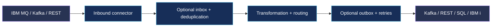

 

**An enterprise integration, data transformation and application modernization ecosystem.**

**Integration without boundaries. Modernization without disruption.**

---

## ✦ What is Kynexisz?

**Kynexisz** is an evolving cloud-native software ecosystem designed to connect enterprise systems, transform information and make existing applications available through modern interfaces.

Its architecture brings together **Kubernetes-native operations**, **Apache Camel integration routes**, **pluggable transformation providers**, and **enterprise observability**—with a particular focus on bridging legacy platforms and modern distributed systems.

> **Vision:** One consistent foundation for event-driven integration, synchronous API orchestration, reliable message delivery and incremental application modernization.

## ◈ The platform at a glance

  

| Building block | Purpose |
| :-- | :-- |
| **⚡ Transformation Engine** | Java / Quarkus runtime using Apache Camel for integration pipelines, routing and transformation. |
| **☸️ Transformation Operator** | Go-based Kubernetes operator for declarative configuration, deployment and lifecycle management. |
| **◉ Management Console** | Vaadin-based user experience for exploring pipelines, deployments, runtime health and operations. |
| **🔌 Enterprise Connectivity** | Integration patterns for Kafka, IBM MQ, REST, SOAP, SQL, S3 and IBM i / JT400. |
| **🛡️ Reliability & Governance** | Configurable inbox/outbox, idempotency, retry strategies, security policy and tenant isolation. |
| **📈 Observability** | Metrics, logs and traces with OpenTelemetry, Prometheus and Grafana-compatible tooling. |

## ⚙️ Designed for real enterprise workloads

<table>
<tr><td width="50%" valign="top">

### 🔄 Connect & transform

- Event-driven and synchronous request/response flows
- XML, JSON, Avro, XSLT and extensible mappings
- Apache Camel native and custom connectors
- Reusable, versioned pipeline definitions

</td><td width="50%" valign="top">

### 🛡️ Deliver reliably

- Inbox/outbox and configurable deduplication
- Retry, redrive and failure management
- Instance-scoped connector configuration
- Auditing and traceability

</td></tr>
<tr><td width="50%" valign="top">

### ☸️ Operate cloud-natively

- Kubernetes custom resources and reconciliation
- Scaling and health monitoring
- GitOps-friendly configuration
- Environment-aware deployments

</td><td width="50%" valign="top">

### 🧩 Modernize incrementally

- Expose legacy capabilities through modern APIs
- Connect IBM i programs and data with JT400
- Support event and API integration side by side
- Extend pipelines with new connectors and processors

</td></tr>
</table>

## 🧭 Example integration patterns

**Typical scenarios:** IBM MQ → Kafka · XML → JSON/Avro · REST → REST · SOAP modernization · IBM i program calls → REST APIs.

## 🏗️ Technology ecosystem

| Layer | Technologies |
| :-- | :-- |
| Runtime | Java, Quarkus, Apache Camel |
| Orchestration | Go, Kubernetes, controller-runtime, KEDA |
| Console | Vaadin, Quarkus, OpenAPI |
| Messaging & integration | Kafka, IBM MQ, REST, SOAP, gRPC, JT400 |
| Transformation | XSLT / Saxon, XML, JSON, Avro, pluggable processors |
| Persistence & artifacts | PostgreSQL, Liquibase, Apicurio Registry |
| Security | OIDC, Keycloak / compatible identity providers, Kubernetes Secrets |
| Observability | OpenTelemetry, Prometheus, Grafana |

## 🧪 Project status

Kynexisz is **under active development**. The capabilities shown here describe the architecture and intended platform scope; individual features may be implemented, evolving or planned. This page is not a claim of general availability or production certification.

### 🔭 On the roadmap

- Expanded connector ecosystem and transformation providers
- Enhanced management and operational insights
- AI-assisted mapping, validation and pipeline diagnostics **(exploratory)**
- Further enterprise hardening and deployment automation

## 🤝 Explore Kynexisz

Development repositories may be private while the platform is being built. Public code, documentation and releases will appear under the [Kynexisz GitHub organization](https://github.com/kynexisz) when published.

**KYNEXISZ** · *Connect Everything. Transform Anything.*

Built for enterprise integration · Designed for modernization · Engineered for Kubernetes

